# Gatekeeper — One-Page Project & Impact Flow Diagram
**IUB Innovation to Impact (i2i) Award Program | Phase 1, 2026**

> *This diagram illustrates the user-centered flow of Gatekeeper—from the core problem faced by university event organizers to the delivered outputs and long-term societal and commercial impact routes.*

---

## Visual Impact Diagram (One View)

```mermaid
flowchart TD
    subgraph S1["1. PROBLEM / NEED"]
        P1["Manual Paper Check-in Lists"]
        P2["Severe Gate Queues (45s per entry)"]
        P3["Ticket Forgery & Unverified Certificates"]
    end

    subgraph S2["2. TARGET USER / CLIENT"]
        U1["Primary: IUB Division of Student Affairs & Student Clubs (IUBPC, FabLab)"]
        U2["Secondary: External Event Agencies & University Summits"]
    end

    subgraph S3["3. EXISTING OUTPUT (Gatekeeper Platform)"]
        O1["Mobile Camera QR Scanner (<2s scan)"]
        O2["Self-Entry Kiosk Terminal"]
        O3["Real-time Gate Capacity Analytics"]
        O4["Automated PDF Certificate Generator & Verifier"]
    end

    subgraph S4["4. INPUTS NEEDED"]
        I1["Official DSA Campus Deployment Mandate"]
        I2["Cloud Database & SMS Gateway Hosting Support"]
        I3["i2i Mentorship for B2B SaaS Commercialization"]
    end

    subgraph S5["5. PROCESS / PATHWAY"]
        W1["Phase 1: Registration & Encrypted QR Ticket Issuance"]
        W2["Phase 2: Instant Gate Access & Real-Time Capacity Tracking"]
        W3["Phase 3: Post-Event Automated Certificate Generation"]
        W4["Phase 4: Public Verification via Authenticity Hash"]
    end

    subgraph S6["6. OUTPUTS & IMPACT ROUTE"]
        R1["Institutional Impact: Zero Gate Queues & 100% Verified Credentials at IUB"]
        R2["Commercial Route: B2B Event Management SaaS for Bangladesh Market"]
        R3["Employability: Production-grade Engineering Portfolio for Student Developers"]
    end

    S1 --> S2
    S2 --> S3
    S3 --> I4["Support Requested"] --> S4
    S4 --> S5
    S5 --> S6
```

---

## Flow Component Breakdown

| Component | Key Details |
| :--- | :--- |
| **1. Problem / Need** | Manual event access at campus venues causes major entry queues (up to 45 seconds per person), risk of crowd safety hazards, vulnerability to ticket duplication, and days of post-event administrative burden typing attendee lists for certificate generation. |
| **2. Target User / Client** | **Primary:** IUB Division of Student Affairs (DSA), IUB Student Clubs (IUB Photography Club, IEEE, FabLab, Club Forum). **Secondary:** External private universities, corporate convention centers, and event management agencies across Dhaka. |
| **3. Existing Output** | A fully built, tested, production-grade web application (`iubpc-gatekeeper`) featuring instant browser-based QR scanning, self-service kiosk check-in, real-time analytics dashboards, and automated PDF certificate issuance with tamper-proof verification. |
| **4. Inputs Needed** | Institutional adoption sanction from IUB DSA, minor cloud hosting budget support (Supabase Pro & SMS ticket API), and business/IP mentorship through the i2i incubation track. |
| **5. Process / Pathway** | 1. **Organizer Setup:** Create event, set registration fields, custom pass layout. 2. **Attendee Registration:** Guests register online and receive encrypted QR passes. 3. **Gate Scanning:** Volunteers scan passes via phone camera; system verifies in <2 seconds. 4. **Instant Issuance:** Attendees receive verifiable digital certificates immediately after event completion. |
| **6. Outputs & Impact Route** | **Campus Scale:** Eradicates event entry queues, enforces zero ticket fraud, and automates 100% of certificate workflows at IUB. **Commercial Scale:** Expands into a subscription SaaS platform for event organizers nationwide. **Career Impact:** Equips student lead & developers with scalable, real-world deployment experience. |
